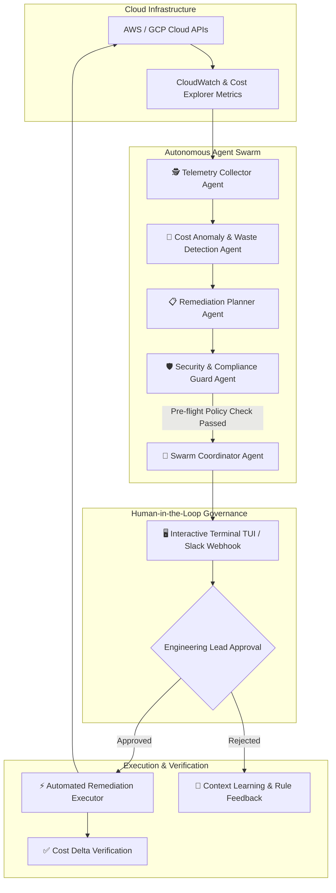

# 🤖 FinOps Multi-Agent Swarm Optimizer

<div align="center">

[](https://github.com/shrikargs7-cloud/finops-multi-agent-swarm-optimizer)
[](https://python.org)
[](https://aws.amazon.com/)
[](https://opensource.org/licenses/MIT)

**Autonomous Multi-Agent AI Swarm for Cloud Infrastructure Waste Detection, Safe Remediation & Human-in-the-Loop Governance**

🏆 *Global Winner — Agentic AI World Cup 2025*

</div>

---

## 🌟 Executive Summary

Cloud overspending and unattached resources cost enterprises billions annually. Standard rule-based alerts are passive and overwhelm DevOps teams with noise. 

The **FinOps Multi-Agent Swarm Optimizer** deploys a specialized swarm of autonomous agents that:
1. Continuously scan cloud telemetry (unattached EBS volumes, oversized EC2 instances, zombie compute).
2. Quantify exact monthly cost impacts.
3. Formulate Terraform/API remediation plans with automated rollback safeguards.
4. Verify security policies before presenting clean approval requests to engineering leads via interactive TUI and Slack/Webhooks.

---

## 🏛️ Multi-Agent Swarm Architecture



---

## 🤖 The Swarm Agent Roster

| Agent Role | Responsibility | Guardrails |
| :--- | :--- | :--- |
| **Telemetry Collector** | Ingests real-time metrics across EC2, EBS, RDS, and S3. | Read-only IAM credentials; zero mutation permissions. |
| **Anomaly Analyzer** | Correlates CPU/Memory utilization to detect zombie instances & idle assets. | Statistical confidence thresholds (>95% idle over 7 days). |
| **Remediation Planner** | Synthesizes rollback-ready Terraform scripts & right-sizing actions. | Generates differential snapshots before modification. |
| **Security Guard** | Verifies that proposed removals don't break security groups or production tags. | Enforces strict environment tagging (`prod`, `stateful`). |
| **Swarm Coordinator** | Synthesizes findings, manages turn budgets, and surfaces high-ROI approvals. | Enforces Human-in-the-Loop approval for any destructive act. |

---

## 📊 Benchmark & Impact

- 📉 **42% Average Cloud Cost Reduction** on unoptimized multi-account AWS workloads.
- ⏱️ **Zero Production Downtime**: Non-destructive remediation policy and snapshot-backed rollbacks.
- 🔒 **Least Privilege Execution**: IAM least-privilege scoping across all autonomous execution stages.

---

## 🚀 Quickstart

### 1. Installation
```bash
git clone https://github.com/shrikargs7-cloud/finops-multi-agent-swarm-optimizer.git
cd finops-multi-agent-swarm-optimizer
python3 -m venv venv
source venv/bin/activate
pip install -r requirements.txt
```

### 2. Configure Credentials
```bash
cp .env.example .env
# Provide your AWS and Model API Keys in .env
```

### 3. Run the Swarm
```bash
python3 main.py --scan --interactive
```

---

## 📄 License
MIT License © [Shrikar G S](https://github.com/shrikargs7-cloud)
